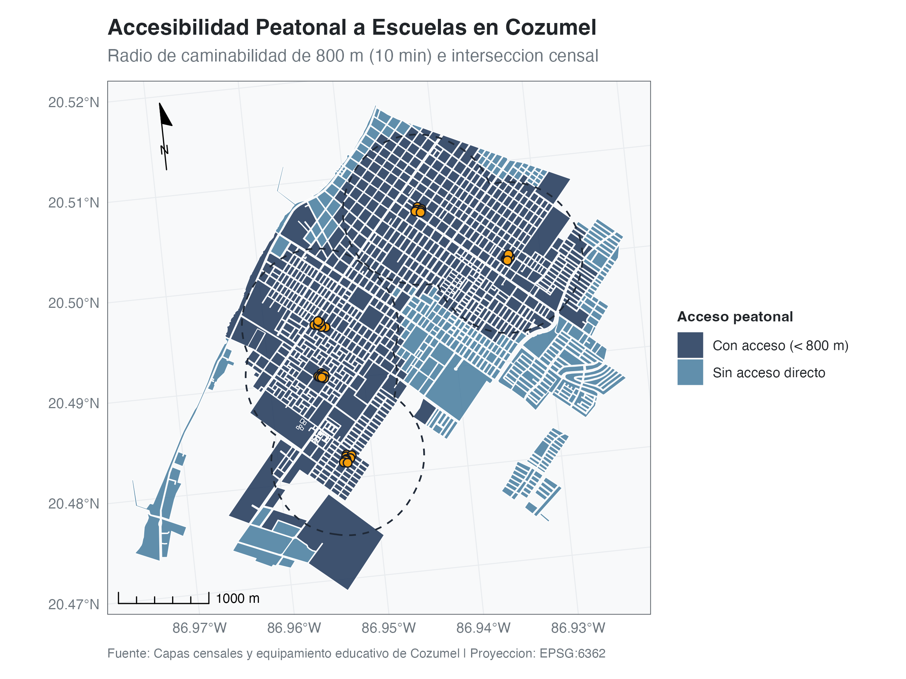

## 1. The Context-Handoff Problem

Large Language Models (LLMs) have revolutionized code generation, but integrating them into a rigorous spatial data science workflow introduces a major friction point: the context handoff. When an analyst wants an LLM to write a spatial pipeline, they must manually extract and paste column names, Coordinate Reference Systems (CRS), geometry types, and styling guidelines into the chat interface. This manual transfer breaks the state of flow, frequently introduces hallucinations (e.g., the LLM hallucinating a `latitude` column that does not exist), and creates a disconnect between the code generation and the final reproducible report.

`mapagen` eliminates this friction. By sitting directly inside your R environment, it securely scans your spatial data catalogs and orchestrates prompts via the `ellmer` package. It injects your data schemas, project objectives, and corporate design rules straight into the LLM context, acting as a true programmatic copilot for `sf`, `terra`, and `ggplot2`.

## 2. Project Scaffolding & Context Generation

The foundation of an agentic workflow is an organized, predictable directory structure. To begin, `mapagen` scaffolds a standardized project environment containing pre-configured Quarto templates, a figure registry, and a `style.json` file that centralizes your typographic and color rules.

Once your raw data is placed in the `data/raw/` directory, the `build_context()` function scans the files. Crucially, this function is lightweight: it does not load massive geometries or heavy rasters into memory. Instead, it extracts bounding boxes, CRS EPSG codes, and a small schema sample, creating a `context_metadata.json` file that serves as the LLM's map of your data.

```{r, eval=FALSE}
# Install directly from the repository
# Install packages
## remotes::install_github("ricardoochoasosa/mapagen", force = TRUE)
## install.packages("ellmer")

# Load the core ecosystem
library(mapagen)
library(sf)
library(ggplot2)

# Authenticate with Gemini API (uncomment to configure)
## usethis::edit_r_environ()
## Add the following line to your .Renviron file:
## GEMINI_API_KEY="your_api_key_here"

# Initialize the project structure
init_agent_project(path = "cozumel_walkability")
setwd("cozumel_walkability")

# Build the spatial and tabular context catalog
build_context()
```

## 3. The Programmatic Copilot: Cozumel Walkability Case Study

To demonstrate the workflow, consider a scenario where we need to evaluate pedestrian accessibility to schools in Cozumel. We have two raw files: a GeoJSON of census polygons with population counts, and a GeoJSON of school point locations.

Instead of writing the spatial joins and buffer calculations from scratch, we pass a natural language prompt to the `ask_code()` function. Behind the scenes, `mapagen` appends our exact data schemas and our `style.json` rules to this prompt.

```{r, eval=FALSE}
# 1. Define the natural language prompt
my_prompt <- "Generate a spatial analysis to evaluate pedestrian accessibility to schools in Cozumel. 
1. Read the 'children.geojson' and 'schools.geojson' layers. Ensure both are in the project's preferred metric CRS for accurate spatial calculations.
2. Create an 800-meter buffer around all schools and unify the resulting geometries into a single coverage polygon.
3. Identify the census polygons (children) that intersect with this school coverage.
4. Generate a map overlaying the school coverage, school points, and census population.
5. Crucial: Strictly use mapagen's styling functions (theme_from_json, scale_fill_mapagen, add_cartographic_decorations) and export the final map using export_iteration(), registering it with the ID 'cozumel_walkability_map'."

# 2. Send the prompt to the LLM agent
## Note: This might take a few seconds while Gemini processes the context and generates the code.
agent_response <- ask_code(prompt = my_prompt)

# 3. Print the full response (agent's reasoning + code block)
print(agent_response)
```

The agent processes the request, correctly identifies the spatial layers, and returns a robust, reproducible R script. It automatically handles reprojection to the project's preferred metric CRS, performs the 800-meter buffer and intersection, and styles the output using our custom `theme_from_json()` engine.

```{r, eval=FALSE}
# 4. Extract and print only the clean R code
cat(agent_response$code)

# 5. Define the target path for the generated script
script_path <- "scripts/01_cozumel_analysis.R"

# 6. Save the generated R code to the script file
writeLines(agent_response$code, script_path)

# 7. Execute the generated script to create and export the map
source(script_path)

```

Executing this generated script creates the analytical map and saves it securely to the output directory.

```{r echo=FALSE, out.width="100%", fig.cap="Pedestrian accessibility map generated by the agent"}

```

### 3.1 Traceability and Analytical Narratives

A key feature of the `mapagen` workflow is the `export_iteration()` function. When the script saves the map, it simultaneously extracts the underlying numerical data and saves it as a structured JSON artifact linked to the figure in the project's registry. For our Cozumel analysis, the extracted data reveals that out of 1,199 total census polygons, 873 have pedestrian access to the 34 schools, representing a coverage of 72.81%.

```{r, eval=FALSE}
# Read and display the numerical summary extracted by export_iteration()
json_path <- "output/figures/mapa_caminabilidad_cozumel_v1_data.json"
cat(readLines(json_path), sep = "\n")
```

Because this data is safely serialized, we can use the `ask_narrative()` function to ask the LLM to write a technical summary based *strictly* on these extracted metrics, ready to be embedded into our final report.

```{r, eval=FALSE}
# 8. Request an analytical narrative based on the numerical data exported by the figure
narrative <- ask_narrative(id = "cozumel_walkability_map")

# 9. Print the resulting narrative
cat(narrative)
```

## 4. The Interactive Copilot (Shiny UI)

While the console-based programmatic workflow is powerful, exploratory spatial data analysis is often highly visual. For a human-in-the-loop experience, `mapagen` includes a local Shiny application.

```{r, eval=FALSE}
# Launch the local Shiny application for interactive, human-in-the-loop mapping
run_geo_agent()
```

The Interactive Copilot provides a conversational interface where the agent proposes an action plan before executing any code. You can approve the plan, watch the map render in the application viewer, request iterative adjustments to the visual styling, and finally click "Eject to Script" to send the polished R code directly to your RStudio environment.

## 5. Dynamic Reporting with Quarto

The ultimate goal of any spatial analysis is communication. `mapagen` ensures that your workflow transitions flawlessly from data exploration to the final deliverable.

Because every generated plot and its associated metadata are logged in `figures_registry.json`, embedding your findings into a Quarto document requires no hardcoded file paths. The `include_figure()` helper function automatically retrieves the latest version of the requested map, formats it with the correct HTML/Markdown syntax, and appends the appropriate caption and data source citations.

```{r, eval=FALSE}
#| label: fig-walkability
#| echo: false
#| results: asis

mapagen::include_figure(id = "cozumel_walkability_map")
```

